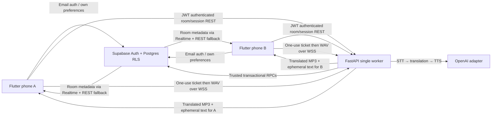

# AI Live Translator — MVP architecture

Status: implemented foundation and turn-based translation path; not a production release.

## Audio behavior

The implemented transport is secure WebSocket **turn-based** speech translation, not continuous
WebRTC or a direct OpenAI Realtime session. Each person connects their own socket; each direction
has an independent sequential pipeline. The client records PCM16 mono 16 kHz into bounded memory,
wraps it as WAV, and sends a turn up to 12 seconds. The server validates the actual WAV duration
(hard maximum 15 s), reserves quota atomically, then transcribes, translates and synthesizes.
Only the partner receives generated audio. Both see transient text. No raw speech is sent to the
partner, no recording is written to the database, and no transcript is saved.

Translation-only instructions treat the transcript as untrusted data. Prompt instructions reduce
conversational responses but do not guarantee semantic correctness; bilingual acceptance tests are
required. Providers implement `Translator`; the mock adapter exists only under `backend/tests`.
Uzbek is an opt-in experimental pipeline. There is no claim of verified Uzbek ASR or TTS quality.
Operators can add a language code through `ENABLED_LANGUAGES`; the adapter uses full names for
known languages and ISO codes for additional languages. Test provider support before enabling.

The microphone cannot start during playback. Incoming audio waits while recording, with a
maximum queue of three turns. Forty on-screen text turns are retained in memory. Playback
interruption/device removal/backgrounding stops capture, clears queued audio and closes the
socket. Every reconnect requires a new one-use server credential. Dropped turns are not replayed
and audio does not reconnect automatically: users must check their output and consent state.
The app requests echo cancellation/noise suppression, whose effectiveness depends on hardware.
Headphones remain required for acceptance; loudspeaker feedback is not certified.

## Trust boundaries

- Flutter has a public Supabase key and user JWT only. AI and `service_role` keys remain server-side.
- Every protected REST request verifies the JWT with Supabase Auth, including email confirmation
  and rejection of anonymous users. UUID inputs and language codes are validated.
- Active membership and room expiry are checked before each turn and again before delivery.
  A five-second heartbeat checks revocation, leave, deletion and expiry while connected.
- Opaque session tickets expire after 60 seconds and are consumed once. They are not provider
  credentials; they authorize this server's WSS relay. Tickets are sent in the first frame, never URLs.
  Live connections close after five minutes; users reconnect explicitly. Server restart invalidates tickets.
- Room codes have 80 bits of randomness (16 symbols from a 32-symbol alphabet) and HMAC-SHA256
  with a server pepper. Codes are shown only at creation, are single use, and expire with the room.
- A row lock on the room serializes joins. A trigger independently enforces capacity of two.
- RLS restricts client reads and profile/preferences updates. Clients cannot call privileged RPCs,
  alter room membership, write usage or modify subscriptions. Join hashes have no client SELECT grant.
- Per-user and per-IP process-local limits protect room creation, joins, session minting and turns.
  TLS ingress must also enforce IP limits and body/frame size limits. Forwarded IP headers are not trusted.
- Each turn reserves server-measured speech seconds using a subscription row lock. Current limits
  are Free 600 / Pro 7200 / Business 36000 seconds per UTC calendar month. Paid plans require an
  active, unexpired server entitlement. Free requires no payment period end.
- Failed/undelivered turns remain reserved: upstream charges may already have occurred. A future
  billing ledger should reconcile actual provider charges and idempotent refunds, not infer success
  from a client's disconnect. The configured estimate is not actual token-level accounting.
- App data deletion cascades from the Auth account. Shared room metadata may consequently disappear
  from the partner's history. Provider retention is controlled separately by the API account.

## Deployment constraints and next milestones

Deploy **one process, one replica**, up to 200 connected peers (100 rooms). This is a deliberate
bounded MVP topology, not a high-availability architecture. Multiple replicas break presence,
tickets and limits. For scale: Redis atomic tickets/limiting, shared presence, encrypted transient
pub/sub with no audio persistence, session affinity or a dedicated audio gateway, measured
backpressure, provider concurrency/circuit breakers and distributed usage reconciliation.

PostgreSQL 18 migration/RLS tests were executed with a minimal Supabase Auth-function shim,
including concurrent join/quota tests. This is not a live Supabase Auth/PostgREST/Realtime test.

Flutter analysis/tests and a web release build have passed. Hosted Supabase confirmed-password
authentication, signup triggers, private-data RLS, two-user room admission, allowance/history,
two-client audio socket admission, one-use ticket rejection and room-close revocation have been
exercised with temporary accounts that were deleted afterward. This did not exercise speech
translation, email delivery/callbacks or Realtime notifications.

Missing release milestones: live paid AI integration, verified email delivery/callbacks, on-device
Bluetooth/route/background/latency/endurance tests, verified Uzbek provider, continuous VAD or
Realtime/WebRTC adapter, production payment webhooks/store billing, transcript-consent persistence,
operational monitoring/alerts, load testing, release signing and store submission.
Background recording is intentionally disabled; no unsupported background entitlement is enabled.
Native runner scaffolds are generated by the installed Flutter SDK using the bootstrap script.
